# CYD Demoscene

Old school demo effects, a BBS-style ANSI art player and an ANSI desk clock for the **ESP32-2432S028R "Cheap Yellow Display"** (CYD): a $12 ESP32 board with a 320x240 touch screen.

| | | |
|---|---|---|
| 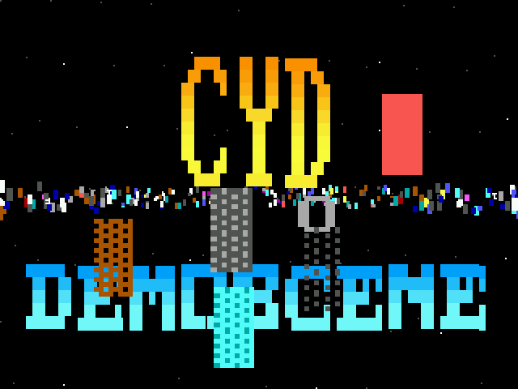 | 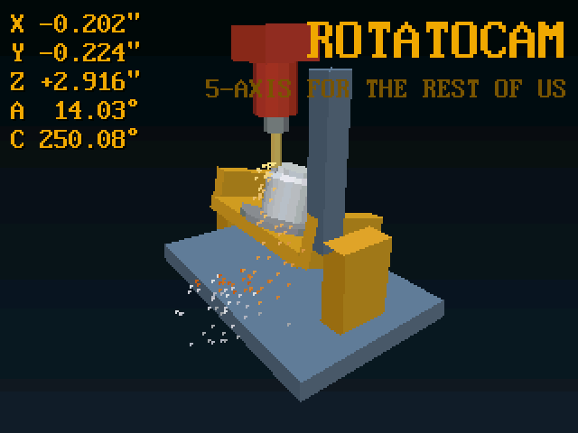 | 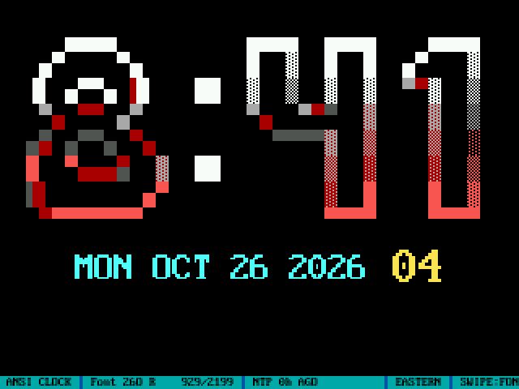 |
| 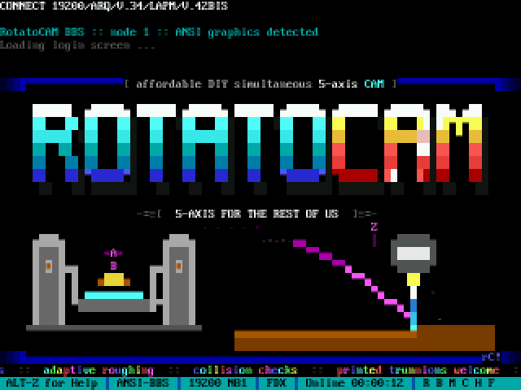 | 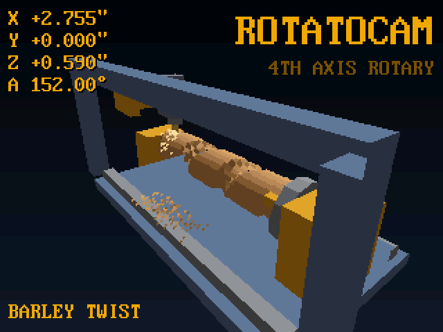 | 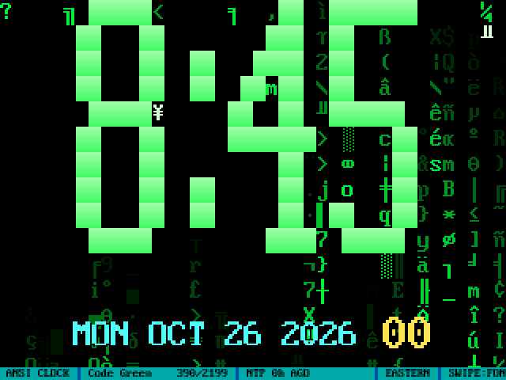 |

*Screenshots captured straight off the board.*

<p align="center"><a href="https://buymeacoffee.com/revjmoney"></a></p>

Want a CYD that's ready to go? **[jmscnc.com](https://jmscnc.com)** sells them in an acrylic case with a stylus and USB cable, already flashed with [Cell Pet](https://jmscnc.com/product/cell-pet-a-living-desk-pet-on-a-2-8-touchscreen-ready-to-plug-in/) or [Duck Pet](https://jmscnc.com/product/duck-pet-toy-ducklings-on-a-2-8-touchscreen-pond-ready-to-plug-in/). Both are in this firmware too (see the end of this page).

It opens with the **ANSI explosion**: the RotatoCAM splash dials in and types out like a BBS, then on the drop all 823 characters tear loose into 3D, swirl in a vortex, and slam back together as a giant palette-cycling "CYD DEMOSCENE" logo with a ring of leftover characters orbiting it.

Next up is **RotatoCAM 5-Axis**: a flat-shaded 3D trunnion machine (tilting A-axis cradle, spinning C-axis platter) carving a fluted part out of aluminum stock in real time, chips flying, with an amber DRO reading out X/Y/Z in inches. Drag to orbit the camera.

Other headline parts:
- **RotatoCAM 4th Axis:** a desktop router with a rotary unit. Stock spins between a chuck and tailstock while the router rides the bridge, roughing in layers and then finishing a turned table leg, a barley-sugar twist or a rope twist.
- **Chrome Raymarch:** four metaballs sphere-traced in real time at 64x48 on both cores, reflecting a synthwave sunset and grid floor, upscaled 5x with bilinear filtering and an ordered dither.
- **Second Reality tribute:** Future Crew's dot tunnel, then a translucent glenz solid with a smaller one spinning inside it, bouncing on a checkerboard. Written from scratch as a homage (the 1993 original's source is public domain).

After that, 23 more parts loop on their own: plasma, Doom fire, a texture-mapped tunnel, copper bars with a sine scroller, a starfield, a rotozoomer, metaballs, a voxel landscape, glenz vectors, matrix rain, a twister, Kefrens bars, a raycaster, vector bobs, water ripples, a Mandelbrot zoom, the Game of Life, the RotatoCAM BBS splash, **Acid Warp** (full screen; tap for the next picture), the touch finale and the ANSI clock. In between, the ANSI gallery "dials in" and types out real 1990s ANSI art from ACiD, Fire, Impure and Blocktronics packs, then pans through each piece.

| | | | |
|---|---|---|---|
| 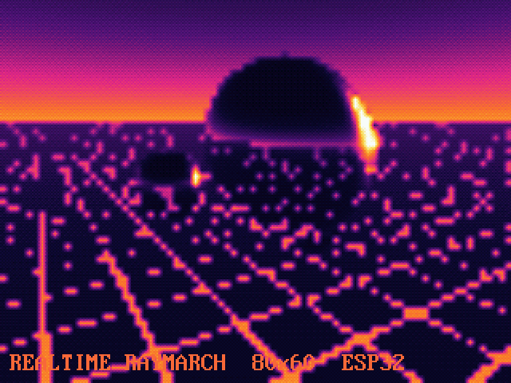 | 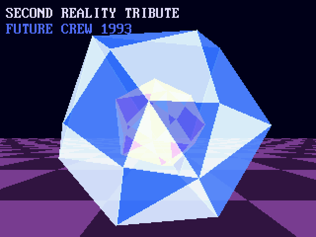 | 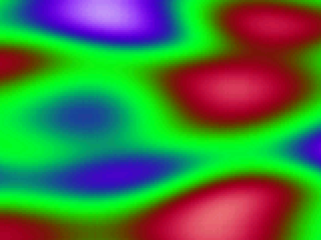 |  |
| 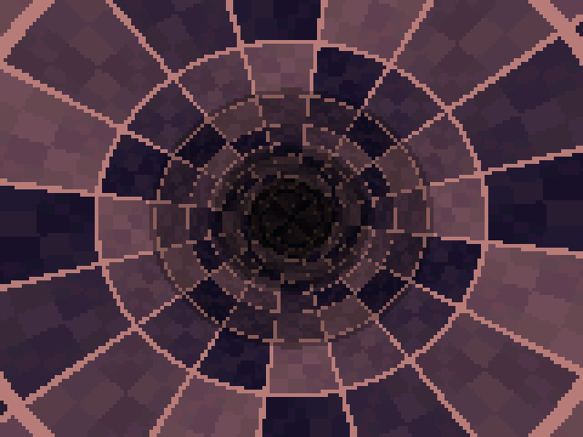 | 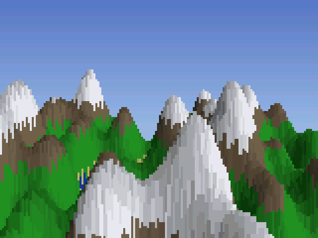 | 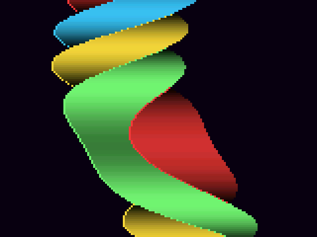 | 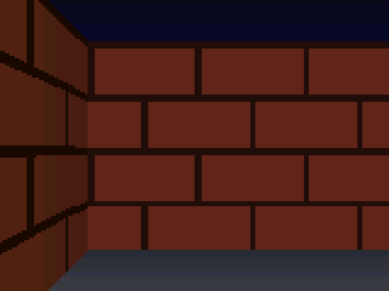 |
| 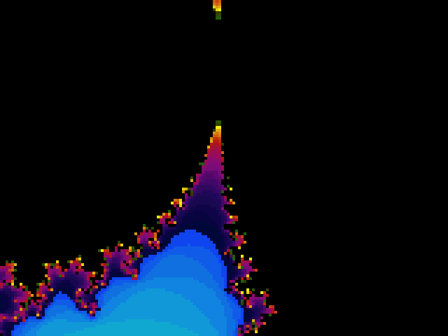 | 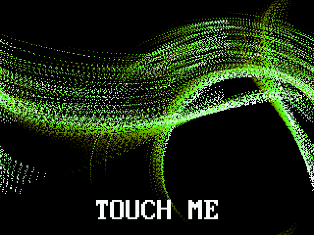 | 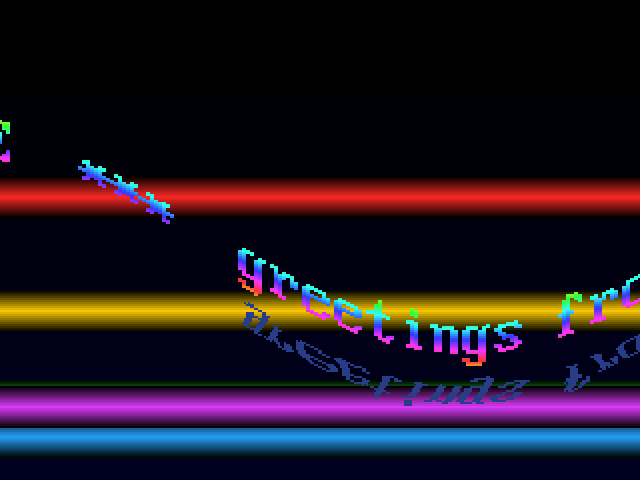 | 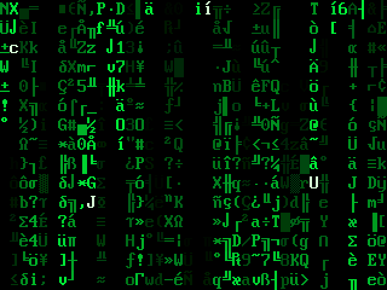 |

## ANSI desk clock

The last part is a desk clock with three styles:
- **ANSI fonts:** the time in **TheDraw (.TDF) fonts**, the block-letter format the ANSI groups (ACiD, iCE, Blocktronics) used for their logos, over a backdrop of your choice: ghosted ANSI art (a new piece every 10 seconds), Matrix rain, a warp starfield, **Acid Warp** (a port of Noah Spurrier's 1993 classic: all 40 picture functions, its palettes and palette rolling), Acid Warp in a dark mode palette that keeps the time readable, or blank.
- **Matrix:** the dash clock of a hovercraft hiding from the Sentinels. A green phosphor CRT (scanlines, dark corners, flicker) shows code rain, a demo effect layer (plasma, a spinning hypercube, a square tunnel, shockwave ripples; it cycles or you pick one), and glitching digits: torn scanlines, a misconverged ghost, cells decaying into code. Every minute or so a Sentinel sweep comes: red alert lamps, the ship powers down and the rain slows, a searchlight crawls down the hull while the digits break up, then power stutters back. The bottom bar is the ship's status readout.
- **Starfield:** warp stars, with a swarm of particles that bursts and regathers into the time every minute.

| | |
|---|---|
| 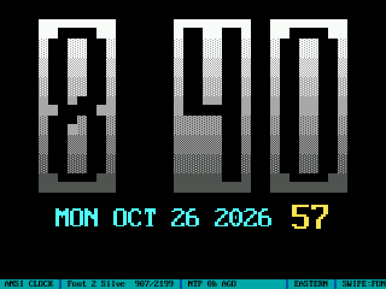 | 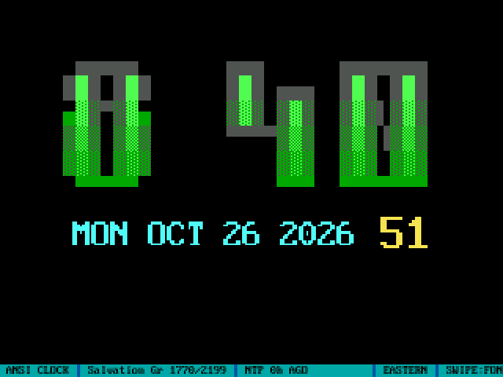 |

Fonts live on the SD card as one pack, `/clock.pak` (build it with `tools/make_font_pack.py` from a folder of .tdf files; one file loads far faster than thousands). Without a card the clock uses a built-in big font. Seconds and the date sit under the time.

- **Swipe up / down:** next or previous font. The first font is a drippy red graffiti face. Between demos the clock shows up in a random style and font each time.
- **Tap:** settings. Style (tap the title row), any font, auto-rotating fonts, 12/24 hour, seconds (off, under the time, or giant), date, timezone, backdrop (ANSI art, Matrix, starfield, Acid Warp, Acid Warp dark or blank; in Matrix style that row picks the effect layer instead; the clock picks a random one when it pops up between demos), "between demos" (the clock shows up for 10 seconds between random 30-second demos), "stay on" (OFF, CLOCK, or PET: CLOCK boots straight into the clock; PET restarts the board into **Cell Pet** or **Duck Pet**, see below; both resync nightly), WiFi and sync.
- **Every 2 minutes** the font clock's digits blow apart cell by cell and fly back together as the new time.
- **Weather:** give it a US ZIP code with `python tools/wifi_set.py COM5 --zip 12345`. At boot, along with the time, it fetches a 3 day hourly forecast from [Open-Meteo](https://open-meteo.com) (free, no account; the ZIP is looked up once on zippopotam.us). The line under the time then takes turns: the date for 6 seconds, then something like `58°F CLEAR H74 L44`. The radio stays off afterwards, so it reads the forecast hour by hour.
- If NTP doesn't answer at boot, the clock takes the time from a web server's Date header instead, and rejoins the WiFi once if nothing gets through.
- **Double tap** on any regular demo jumps to the clock.
- **Time:** NTP at boot. It joins the strongest remembered network in range, or failing that an open one that actually reaches the internet (device hotspots such as TV cast or printer networks are skipped). WiFi then switches off so the demos keep their RAM.
- **Adding a network:** in the settings, tap the left half of the WIFI row (TYPE PASSWORD): the board restarts into a setup screen that lists the networks around it; tap yours and type the password on the touch keyboard (shift, a symbols page, delete). It tests the password before saving. Open networks ask before joining, since TV and printer hotspots are open but have no internet. The right half of the row (ROUTER WPS) uses your router's WPS button instead, or run `python tools/wifi_set.py COM5` and type it on the PC. Networks are stored on the board only. At boot the board tries the saved networks in range strongest first (gadget hotspots last) and moves on to the next one if a network gives no internet.

## Engine

- **Both cores:** core 1 draws the next frame into an 8-bit indexed buffer while core 0 expands the previous one through its palette and streams it to the panel in 16-line DMA strips. Low-res parts are double buffered; full-res parts take turns with the push (about 45 to 60 fps).
- **SPI clock:** the CYD's display pins are the ESP32's native HSPI pins, so the bus can run at 80 MHz (a full-screen frame in about 15.5 ms, roughly 62 fps). Many panels show twitching lines at 80, so the default is the safe 40 MHz setting (asked for as 55; the ESP32 rounds it down). Serial `f` cycles 40/55/80 MHz and reboots, and the choice is saved.
- **Beat sync:** a built-in 125 BPM chip tune is the master clock, and effects pulse on the kick. It's silent by default. The sync still runs, and serial `m` turns sound on if a speaker is plugged into the SPEAK connector (GPIO26, DAC).
- **No heap churn:** each demo and its tables live in one arena reserved at boot, so it can switch demos all day without fragmenting memory.

## Controls

| Input | Action |
|---|---|
| Swipe left / right | Next / previous demo. In the ANSI gallery: next / previous piece, shown instantly |
| Tap | Hold on this demo or piece. Tap again to resume auto-play |
| Drag up / down | Scroll a long ANSI piece by hand |
| Press and hold 1 s | Skip to the next demo, also out of the gallery |
| BOOT button | Next demo |

**Touch scenes:** the tunnel, Doom fire, water and the finale react to your finger. There, a swipe changes demo only if it starts at the left or right edge, so you can play freely. While someone is playing, the show waits; it moves on 15 seconds after the last touch.
- **Tunnel:** the far end bends towards your finger. Drag sideways to twist it, flick up or down to change speed. Left alone, it wanders on its own.
- **Doom fire:** your finger is a torch; drag sideways to blow the flames.
- **Water:** touch to splash, drag to leave a wake.
- **Touch finale:** a galaxy of 1000 glowing particles orbits your finger; tap to blast them outward.

Serial at 921600 baud: `n` / `p` next and previous, `h` hold, `r` rotate 180° (saved), `l` list parts, `g<N>` go to part N, `i` fps, timings and heap, `m` sound on/off, `f` SPI clock, `R` software screenshot.

## Build, flash and install

**You need:**
- **An ESP32-2432S028R (CYD).** Both the ILI9341 and ST7789 panel versions work; the firmware detects which one it has.
- **A USB cable** that carries data, not just power.
- **[PlatformIO](https://platformio.org/)** (the VS Code extension, or `pip install platformio` for the command line).
- **Python 3** with `pyserial` and `Pillow`: `pip install pyserial pillow`.
- **Optional: a microSD card** (FAT32) for the big ANSI gallery and the TheDraw clock fonts. Everything works without one.

**1. Get the code and the ANSI art.**

```bash
git clone https://github.com/revjmoney/CYD-ANSI-DEMOSCENE-CLOCK.git
```

```bash
cd CYD-ANSI-DEMOSCENE-CLOCK
```

```bash
python tools/fetch_ansi.py
```

`fetch_ansi.py` downloads ANSI packs from [16colo.rs](https://16colo.rs) and converts them into compact cell grids: a small set of about 50 pieces in `data/ansi/` that goes into the board's own flash, so the gallery works with no SD card.

**2. Flash the firmware, then the ANSI files.** Plug the CYD in. PlatformIO usually finds the port by itself; if not, add `--upload-port COM5` (Windows) or `--upload-port /dev/ttyUSB0` (Linux/Mac) with your port.

```bash
pio run -t upload
```

```bash
pio run -t uploadfs
```

If the upload can't connect, hold the **BOOT** button while it starts. If the board ran other firmware before and acts strangely, run `pio run -t erase` once first (it wipes the board, including saved settings).

**3. First boot.** The ANSI explosion plays, then the demos loop on their own. To give the clock the time, add your WiFi from the clock's settings (double tap any demo to jump to the clock, then tap it; see **Adding a network** above), or from the PC (it asks for the network name and password, which stay on the board):

```bash
python tools/wifi_set.py COM5
```

For weather under the time, add a US ZIP code:

```bash
python tools/wifi_set.py COM5 --zip 12345
```

To make it a desk clock that boots straight into the clock, set **STAY ON: CLOCK** in the clock's settings.

**4. Optional: the SD card.** The big gallery is about 2,800 pieces from 154 packs, roughly 300 each from ACiD, iCE, Fire, CiA, Mistigris, Remorse, Dark, Impure and Blocktronics, spread across each group's years. Build it into one file, `sd/ansi.pak` (about 29 MB):

```bash
python -I tools/make_ansi_pack.py
```

For the clock fonts, pack a folder of TheDraw `.tdf` fonts (for example the `fonts` folder of [tdfiglet](https://github.com/tat3r/tdfiglet), or the big TDF collections on 16colo.rs) into `clock.pak`. Only fonts with the digits 0 to 9 are kept:

```bash
python -I tools/make_font_pack.py path/to/tdf-fonts sd/clock.pak
```

Copy `ansi.pak` and `clock.pak` to the **root** of the card with a card reader (fastest), put the card in the CYD and restart it. The boot log (serial, 921600 baud) then says `ANSI gallery: 2789 pieces (SD /ansi.pak)`. You can also copy the gallery over USB while the demos run (about 15 minutes):

```bash
python tools/sd_ansi.py COM5
```

The art and fonts are not included in this repository because they belong to their original artists.

## How it works

- `src/board.cpp`: LovyanGFX panel, backlight and XPT2046 touch setup. It probes ILI9341 vs ST7789 the same way bdring's FluidDial does.
- `src/gfx.cpp`: the shared 320x240 8-bit framebuffer, palette and CP437 text. ANSI text uses the IBM VGA 8x16 font, averaged 2x2 down to 4x8 cells, so 80 columns fit across 320 pixels.
- `src/demo.h`: every part is a `Demo` with `update()` and an optional `strip()`, plus `swipe()` and `drag()` hooks. Low-res parts draw 160x120 and are pixel doubled.
- `src/audio.cpp`: integer chip synth, the song, and `syncNow()`, which computes beat, bar and kick/snare envelopes straight from the song data.
- `src/intro.inc`: the ANSI explosion.
- `tools/ans2grid.py`: an `.ANS` to grid converter (ANSI.SYS escapes, iCE colors, SAUCE metadata).
- `tools/extract_rotatocam.py`: pulls the RotatoCAM splash art, font and marquee out of its HTML version.
- `tools/preview_cg.py`: renders a converted grid to PNG.
- `tools/grab_screenshot.py`: grabs frames over serial.

## Support

If this put a demoscene on your desk, buy me a coffee and keep the effects coming: **[buymeacoffee.com/revjmoney](https://buymeacoffee.com/revjmoney)**. Ready-to-plug-in CYD gadgets, CNC tools and more are at **[jmscnc.com](https://jmscnc.com)**.

<p align="center"><a href="https://buymeacoffee.com/revjmoney"></a></p>

## Licenses

Copyright (C) 2026 Rev. J. Money.

This project is free software under the **GNU General Public License v3.0 or later** (see `LICENSE`). You can use, study, change and share it, but anything you distribute that is built from it must also be GPL-3.0 with its source available, and you must keep the copyright notices. As an additional term under GPLv3 section 7(b), copies and derived works must keep the "Copyright (C) 2026 Rev. J. Money" notices and the author credit in this README.

Third-party pieces keep their own licenses and are listed in `THIRD_PARTY_NOTICES.md`.

## Cell Pet and Duck Pet

STAY ON: PET hands the whole board to **Cell Pet** or **Duck Pet** (pick with the PET: CELL / DUCK setting inside, or `@KIND 0|1`). **Duck Pet** is glossy toy ducklings on a pond, with the same week of growing up, squabbles, prey, a passing turtle and the odd evil duckling. **Cell Pet** is a living drop of pond water at full resolution. Nature picks your pet from eight random cells. Over about a week it evolves from one cell into a jellyfish, shaped by the room light, its fights and how you feed it. It also works as a desk clock, has silly achievements, and lights the RGB LED when it eats. Hold the screen for 2 seconds for its settings. **DEMOS** at the top of its settings (or `@STAY 0` over serial) goes back to the demos. Their files in `src/cellpet/` and `lib/evolve/` are shared, unchanged, with the standalone firmware, so both keep the same pets.
